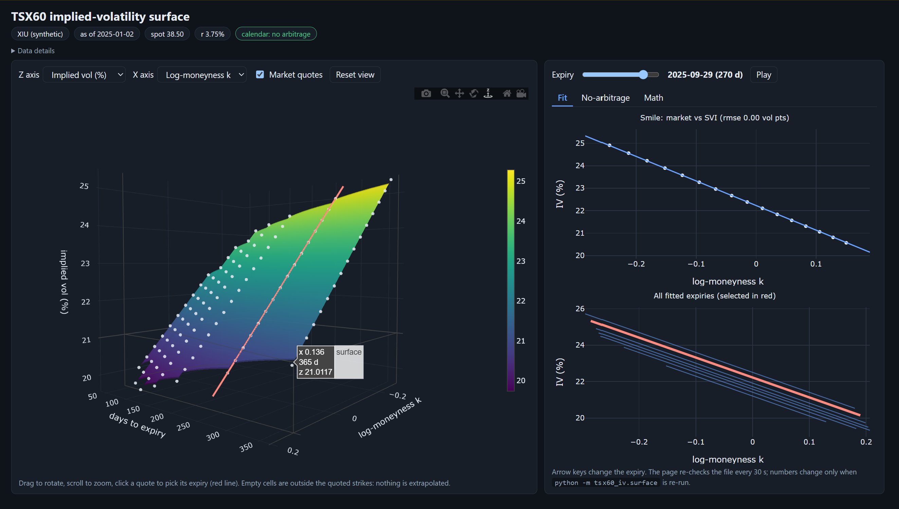
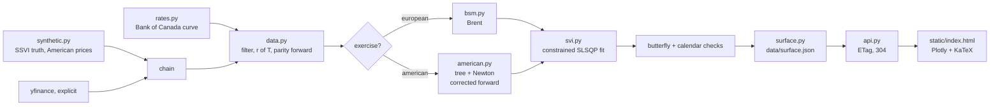

# tsx60-iv-surface

A Python project that builds, validates and serves an implied-volatility surface
for the iShares S&P/TSX 60 ETF (`XIU`), end to end: quotes, risk-free curve,
forward, implied volatility (European or American), per-expiry SVI fits,
no-arbitrage checks, a JSON surface and an interactive 3D page.



> **Every surface in this repository is synthetic.** Yahoo Finance carries no
> `XIU.TO` options, and real Montréal Exchange data is paid, so the demo chain is
> generated from an arbitrage-free surface and real *inputs* (the Bank of Canada
> curve of 2025-01-02 and XIU.TO's spot, realized volatility and dividends). The
> page says so. The point is rigour in the machinery, not a market view.

## Contents

1. [Quick start](#quick-start)
2. [The two exercise variants](#the-two-exercise-variants)
3. [Command-line reference](#command-line-reference)
4. [How the pipeline works](#how-the-pipeline-works)
5. [Mathematics](#mathematics)
6. [Results on the demo](#results-on-the-demo)
7. [Project layout](#project-layout)
8. [Data anchors and live data](#data-anchors-and-live-data)
9. [Invariants, shortcuts and limitations](#invariants-shortcuts-and-limitations)

## Quick start

Python 3.12+ and [`uv`](https://docs.astral.sh/uv/) are required. From the repo
root:

```bash
uv sync                                    # install
uv run python -m tsx60_iv.surface --demo   # build data/surface.json (about 10 s)
uv run uvicorn tsx60_iv.api:app --port 8000
```

Open <http://127.0.0.1:8000/>: an interactive 3D surface, the smile fit, the
Durrleman `g(k)` plot, the term structure and the formulas filled in for the
selected expiry (Fit, No-arbitrage and Math tabs).

| I want to... | Command |
|---|---|
| Rerun the simulation | `uv run python -m tsx60_iv.surface --demo` (the page refreshes within 30 s, no restart) |
| Restart the server | stop it (Ctrl+C), then `uv run uvicorn tsx60_iv.api:app --port 8000 --reload` |
| Free port 8000 (PowerShell) | `Get-NetTCPConnection -LocalPort 8000 -State Listen \| ForEach-Object { Stop-Process -Id $_.OwningProcess }` |
| Run the tests and lint | `uv run pytest` and `uv run ruff check .` |
| Rebuild the PDF | `tectonic docs/tsx60_iv_whitepaper.tex` (needs [Tectonic](https://tectonic-typesetting.github.io/)); first run `uv run python docs/build_walkthrough.py` if the code changed, to refresh its tables and Python session |

The page re-checks `data/surface.json` every 30 s and never contacts Yahoo.
Tests and CI are offline; live downloads only happen with an explicit flag.

## The two exercise variants

`XIU` options are **American-style**, but a closed-form price exists only for
**European** options. The pipeline supports both, selected with
`--exercise european|american`. **`american` is the default** because it is the
correct model for the instrument.

| | `--exercise european` | `--exercise american` (default) |
|---|---|---|
| Pricing model | forward Black-Scholes, closed form | Cox-Ross-Rubinstein binomial tree with early exercise |
| Module | `bsm.py` | `american.py` |
| Inversion | Brent's method, one quote at a time | safeguarded Newton on the tree, vectorized per expiry and side |
| Forward | raw put-call parity | parity **corrected** for early exercise (3 passes) |
| Extra inputs | none | implied yield $q$, optionally a dividend schedule |
| Time on the demo | about 5 s | about 10 s |
| Bias vs the true surface (ATM, mean) | **+0.27 vol points** (worst 0.74) | **+0.003 vol points** (worst 0.07) |
| Use it for | speed, and to measure how much early exercise matters | everything else |

Why they differ. An American option is worth at least a European one,
$V_A(\sigma)=V_E(\sigma)+\text{premium}\ge V_E(\sigma)$, so inverting American
quotes with a European model overstates the volatility by about
$\text{premium}/\mathcal V$. Put-call parity is also a European identity, so the
parity forward is biased too. Both modes still *report* the premium and the vol
bias of every slice, so the cost of ignoring early exercise is visible either
way.

A second, independent choice is the **dividend model** for the American tree,
`--dividends schedule|continuous`:

| | `schedule` | `continuous` |
|---|---|---|
| Idea | discrete cash dividends at known dates | a smooth yield $q$ over the whole life |
| Early exercise valued on | $S^*+\text{PV(remaining dividends)}$ | $S$ |
| Calls just before an ex-date | worth most | understated |
| Default | demo | any non-demo run (no schedule is available) |

The demo's generating process pays discrete dividends, so `schedule` recovers
the truth and `continuous` overstates ATM volatility (covered by a test).
`schedule` is only available with `--demo`.

## Command-line reference

`uv run python -m tsx60_iv.surface [flags]`

| Flag | Default | Meaning |
|---|---|---|
| `--demo` | off | use the generated synthetic chain and the bundled Bank of Canada snapshot |
| `--exercise european\|american` | `american` | pricing and inversion model (above) |
| `--dividends schedule\|continuous` | `schedule` with `--demo`, else `continuous` | dividend model for the tree |
| `--curve PATH` | bundled snapshot in demo | Bank of Canada curve snapshot (JSON) |
| `--rate R` | `0.0375` outside demo | flat continuously compounded rate; not with `--curve` |
| `--min-mid X` | `0.05` | drop quotes with a mid below `X` (five 0.01 ticks): tick-floor quotes give junk vols |
| `--out PATH` | `data/surface.json` | where to write the surface |
| `--chain PATH`, `--spot S` | `data/xiu_chain.parquet` | a cached chain and its spot, outside demo |
| `--fetch`, `--force`, `--ticker T`, `--max-expiries N` | off | explicit live download (see [live data](#data-anchors-and-live-data)) |
| `--mlflow` | off | log the run with MLflow |

## How the pipeline works



1. **Filter** quotes: $b>0$, $a\ge b$, finite mid, relative spread $\le 35\%$.
2. **Time and rate:** $T=\text{days}/365$, $D(T)=e^{-r(T)T}$ with $r(T)$ read from
   the Bank of Canada curve.
3. **Forward** per expiry by put-call parity from the three at-the-money pairs
   (American mode then corrects it).
4. **Out-of-the-money quotes only** (puts below $F$, calls at or above), mid
   $\ge$ `--min-mid`.
5. **Invert** every mid to $\sigma$ row by row. Rows outside the arbitrage bounds
   or without a root are skipped and **counted, never clipped**.
6. **Fit** Raw SVI per expiry (at least 5 points) with butterfly freedom imposed
   as a constraint; expiries that still fail are listed with the reason.
7. **Check** calendar monotonicity across expiries; a failure is reported, not
   repaired.
8. **Mesh and write:** six interpolated rows between expiries (linear in total
   variance, so calendar monotonicity is preserved, and nothing is extrapolated
   outside the quoted strikes), written atomically to `data/surface.json`.

`surface.json` (schema 2) holds `meta` (source, synthetic flag, exercise and
dividend model, rate curve, drop counts), `calendar`, `rejected`, one entry per
fitted expiry (parameters, RMSE in vol points, rate, implied dividend yield,
early-exercise bias, smile and Durrleman grids) and the 3D `grid`.

## Mathematics

Notation: spot $S$, forward $F(T)$, discount $D(T)=e^{-r(T)T}$, log-moneyness
$k=\ln(K/F)$, total variance $w=\sigma^2T$, standard normal CDF $\Phi$ and
density $\varphi$.

### Risk-free curve

The Bank of Canada Valet API gives six nodes: CORRA overnight, the 1, 3, 6 and
12 month Treasury bills and the 2 year benchmark bond (one request per
snapshot). A money-market yield $y$ over tenor $\tau$ becomes a continuously
compounded zero rate by

$$
r=\frac{\ln(1+y\tau)}{\tau}.
$$

The 2 year node is a semi-annual par yield $c$, so its zero rate $r_2$ is
bootstrapped from

$$
\sum_{t\in\{0.5,\,1,\,1.5\}}\frac c2\,e^{-r(t)\,t}+\Bigl(1+\frac c2\Bigr)e^{-2r_2}=1,
$$

with $r(1.5)$ linear between $r(1)$ and $r_2$. $r(T)$ is linear in tenor between
nodes and flat beyond them. Each node uses the last print on or before the
valuation date and raises if it is older than 10 days.

### Forward by put-call parity

For each strike with both a call and a put,

$$
\hat F_i = K_i + \frac{C_i-P_i}{D(T)},\qquad
F(T)=\operatorname{median}\{\hat F_i\ \text{over the 3 pairs nearest to spot}\}.
$$

There is no spot-based fallback: an expiry without a pair is dropped.

### European variant (forward Black-Scholes)

$$
C=D\,[F\,\Phi(d_1)-K\,\Phi(d_2)],\qquad
P=D\,[K\,\Phi(-d_2)-F\,\Phi(-d_1)],
$$

$$
d_{1,2}=\frac{\ln(F/K)\pm\tfrac12\sigma^2T}{\sigma\sqrt T}.
$$

A quote is accepted only inside the static bounds
$D\max(F-K,0)<C<DF$ and $D\max(K-F,0)<P<DK$; the root of
$\text{BSM}(\sigma)=m$ is found with Brent's method on $[10^{-5},5]$ (unique
because the price rises with $\sigma$). Greeks are in forward space and include
$D$: $\Delta_C=D\Phi(d_1)$, $\Gamma=D\varphi(d_1)/(F\sigma\sqrt T)$,
vega $\mathcal V=DF\varphi(d_1)\sqrt T$ (per unit volatility, so 100 times the
per-point figure), vanna $=-D\varphi(d_1)d_2/\sigma$ and volga
$=\mathcal V\,d_1d_2/\sigma$.

### American variant (binomial tree)

With $\Delta t=T/n$, $u=e^{\sigma\sqrt{\Delta t}}$, $d=1/u$ and
$p=\dfrac{e^{(r-q)\Delta t}-d}{u-d}$, backward induction gives

$$
V_{i,j}=\max\Bigl(\text{payoff}_{i,j},\ e^{-r\Delta t}\bigl[p\,V_{i+1,j+1}+(1-p)\,V_{i+1,j}\bigr]\Bigr).
$$

The reported value averages the trees with $n$ and $n+1$ steps to damp the
odd-even oscillation of CRR. The tree is anchored to the parity forward through
the implied yield

$$
q=r-\frac{\ln(F/S)}{T},\qquad\text{so the tree's forward is exactly }F.
$$

**Discrete dividends.** With a schedule, the tree runs on the dividend-free price
$S^*=Se^{-qT}$ and early exercise at time $t$ is valued on
$S^*+\text{PV}_t$, where $\text{PV}_t$ is the value of the dividends still to be
paid before expiry. The schedule only times the dividends: $\text{PV}_0$ is
rescaled to $S-S^*$, so the forward is unchanged (a schedule more than twice off
the forward is ignored). A call is then worth most just before an ex-date.

**Inversion.** A safeguarded Newton iteration on the tree (European vega as the
slope, bisection fallback). Prices at or below intrinsic value, or at or above
the spot (call) or strike (put), have no solution and are skipped and counted.

**Early-exercise premium and bias.** Every slice records

$$
\text{premium}=V_A(\sigma)-V_E(\sigma),\qquad
\text{vol bias}\approx\frac{\text{premium}}{\mathcal V},
$$

and how many quotes have a premium above half their bid-ask spread.

**Forward from American mids.** Parity holds for European prices, so after a
first estimate the premium of every quote within 6% of the forward is subtracted
from its mid and the forward is re-estimated (3 passes converge). On the demo
this cuts the forward error on the expiry that falls on an ex-date from 0.33% to
about 0.01% of $F$.

### Raw SVI per expiry

$$
w(k)=a+b\Bigl[\rho(k-m)+\sqrt{(k-m)^2+s^2}\Bigr].
$$

The fit minimizes $\bar w^{-2}\sum_i (w(k_i)-w_i)^2$ with SLSQP (`ftol` $10^{-10}$)
from three starting points $\rho_0\in\{-0.5,0,0.5\}$, subject to

- box bounds $b\ge0$, $|\rho|\le1-10^{-6}$, $s\ge10^{-6}$;
- minimum variance $a+b\,s\sqrt{1-\rho^2}\ge0$;
- Durrleman's butterfly condition on a grid of the quoted strikes plus 201 points
  on $[\min k-0.5,\ \max k+0.5]$:

$$
g(k)=\Bigl(1-\frac{k\,w'}{2w}\Bigr)^2-\frac{w'^2}{4}\Bigl(\frac1w+\frac14\Bigr)+\frac{w''}{2}\ \ge\ 0.
$$

Butterfly freedom is a **constraint of the fit**, then re-checked on the same
grid; a slice that still fails is rejected, never clamped. Across expiries the
calendar condition is

$$
w(k,T_{j+1})-w(k,T_j)\ \ge\ 0
$$

on the common strike range, i.e. $\partial_T w\ge0$.

### The synthetic truth (SSVI)

The demo surface is a Gatheral-Jacquier SSVI surface,

$$
w(k,T)=\frac\theta2\Bigl(1+\rho\varphi k+\sqrt{(\varphi k+\rho)^2+1-\rho^2}\Bigr),\quad
\theta=\sigma_{\text{atm}}(T)^2T,\quad \varphi=\eta\,\theta^{-\gamma},
$$

which is exactly a raw SVI slice. The code checks $\theta$ increasing,
$\theta\varphi(1+|\rho|)<4$, $\theta\varphi^2(1+|\rho|)\le4$ and
$0\le\partial_\theta(\theta\varphi)\le\frac{1+\sqrt{1-\rho^2}}{\rho^2}\varphi$.
ATM vol rises from 11.5% to 13.5% (XIU.TO's realized vol was 8.8-10.9% in
January 2025), $\rho=-0.65$, $\eta=0.9$, $\gamma=0.4$. Expiries are monthly third
Fridays (Thursday before when that is Good Friday). Each option is priced with
the discrete-dividend American tree at the truth volatility, then quoted with
0.01 ticks, a spread of $\max(0.02,\,5\%\text{ of mid})$ and a seeded random shift
of up to a quarter spread, so the chain is deterministic.

## Results on the demo

Measured against the generating surface (12 of 13 expiries fit; the 15-day one
has too few usable quotes and is listed as rejected):

| Setting | Mean ATM error | Worst ATM error | Worst single-quote error |
|---|---|---|---|
| American, schedule, corrected forward (default) | +0.003 vol pts | 0.07 | 0.31 |
| European | +0.27 | 0.74 | 1.05 |
| American, continuous yield | worse than the schedule (tested) | | |

Other measurements: the early-exercise bias of out-of-the-money quotes is at most
about 0.5 vol points, except for the two expiries on or next to an ex-date
(about 1.9 and 1.0); the 2-year par-yield shortcut would have moved the zero rate
by 0.15 basis points. The ex-date expiry has only 8 quotes and its SVI fit is
fragile: on some platforms the optimizer rejects it, and the pipeline then
reports it instead of repairing it.

## Project layout

| Path | Role |
|---|---|
| `src/tsx60_iv/data.py` | `yfinance` ingestion, quote quality, per-expiry rates, parity forwards |
| `src/tsx60_iv/bsm.py` | forward BSM price, Greeks, Brent inversion |
| `src/tsx60_iv/american.py` | CRR tree, discrete dividends, Newton inversion, early-exercise bias |
| `src/tsx60_iv/rates.py` | Bank of Canada curve, bootstrap, snapshots |
| `src/tsx60_iv/market_params.py` | free Yahoo-derived anchors (spot, realized vol, dividends) |
| `src/tsx60_iv/synthetic.py` | legacy fixture chain and the realistic SSVI demo chain |
| `src/tsx60_iv/svi.py` | raw SVI, constrained calibration, butterfly and calendar checks |
| `src/tsx60_iv/surface.py` | the pipeline and its CLI |
| `src/tsx60_iv/api.py` | FastAPI app: `/`, `/surface` (ETag, 304, 503), `/health` |
| `src/tsx60_iv/static/index.html` | 3D page (Plotly.js and KaTeX from pinned CDN versions) |
| `src/tsx60_iv/tracking.py` | optional MLflow logging |
| `src/tsx60_iv/data_files/` | checked-in snapshots of the two anchors |
| `tests/` | deterministic offline tests; `tests/fixtures/` holds the regression chain |
| `docs/tsx60_iv_whitepaper.tex` / `.pdf` | a self-contained tutorial: options and pricing basics, American vs European, the algorithm in pseudo-code, and a worked example with real quote tables and a Python session |
| `docs/build_walkthrough.py`, `docs/generated/` | regenerate the tables, figures and Python session that the PDF includes (computed by the library itself) |
| `docs/README.md` | architecture and function-by-function reference |

## Data anchors and live data

The two anchors are checked-in snapshots. Regenerating them is an explicit,
free, one-request-each network call:

```bash
uv run python -m tsx60_iv.rates --as-of 2025-01-02 --out src/tsx60_iv/data_files/boc_curve_2025-01-02.json
uv run python -m tsx60_iv.market_params --as-of 2025-01-02 --out src/tsx60_iv/data_files/xiu_market_params.json
```

The first reads the Bank of Canada Valet API (open data, see
<https://www.bankofcanada.ca/terms/>); the second derives XIU.TO's closing spot,
realized volatility and trailing dividends from Yahoo Finance (statistics only,
no price series is stored). Neither is called by tests or CI.

Yahoo Finance returns no options for `XIU.TO`, so there is no live XIU source. For
a Yahoo-listed ticker a live download is explicit, capped and polite (one request
per expiry, a pause between them, no retries, a 30-minute cooldown unless
`--force`):

```bash
uv run python -m tsx60_iv.surface --fetch --ticker EWC --rate 0.043 --max-expiries 6
```

Regenerate the offline test fixture with
`uv run python tests/fixtures/generate_xiu_sample.py`.

## Invariants, shortcuts and limitations

Invariants enforced in code and tests:

- Prices use the forward $F(T)$ and $D(T)=e^{-r(T)T}$; quotes outside the
  intrinsic and discounted-forward bounds are rejected.
- $w(k,T)$ is nonnegative and monotone in $T$; **arbitrage is never clamped
  into validity**, only reported.
- Tests are offline; live access happens only on an explicit flag.

Known shortcuts:

- Expected dividends are the trailing four, repeated a year later, with no growth.
- The curve is one snapshot (2025-01-02), flat beyond 2 years.
- SVI is a local multi-start, not a global optimizer; the 0.35 spread filter, the
  three-strike forward window and the 0.05 mid floor are fixed choices.
- Montréal Exchange data is not used; the demo is synthetic by design.

See `docs/tsx60_iv_whitepaper.pdf` for the full tutorial and write-up and
`docs/PROGRESS.md` for the development log.
