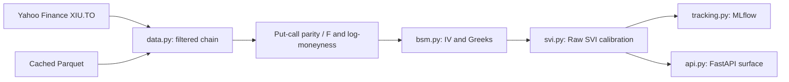

# tsx60-iv-surface

A production-oriented Python library for modeling, calibrating, and serving the
implied volatility surface of the Canadian S&P/TSX 60 Index through liquid
`XIU.TO` (iShares S&P/TSX 60 Index ETF) option chains.


## Project Overview & Architecture

The package is intentionally small: data ingestion produces normalized quotes;
forward BSM routines calculate prices, Greeks, and implied volatility; SVI is
the slice-calibration boundary; and MLflow/FastAPI handle experiment tracking
and serving.



The `src/tsx60_iv` package keeps numerical logic separate from external I/O.
Tests use a checked-in synthetic chain, so unit and property tests are fully
offline and deterministic.

## Mathematical Formulation

### Forward Black-Scholes-Merton Pricing & Log-Moneyness

Let $F(T)$ be the forward, $D(T)=e^{-rT}$ the discount factor, and
$k=\ln(K/F(T))$. Under forward BSM:

$$
C(K, T) = D(T)\left[F(T)\Phi(d_1) - K\Phi(d_2)\right],
\quad d_{1,2} = \frac{-k \pm \frac{1}{2}\sigma^2 T}{\sigma\sqrt{T}}.
$$

For puts:

$$
P(K,T)=D(T)\left[K\Phi(-d_2)-F(T)\Phi(-d_1)\right].
$$

Put-call parity,
$C(K,T)-P(K,T)=D(T)(F(T)-K)$, is used to infer the expiry forward from
near-ATM paired quotes.

### Implied Volatility Inversion

Market implied volatility is the root of

$$
f(\sigma_{\text{imp}})=
C_{\text{BSM}}(F,K,T,\sigma_{\text{imp}})-C_{\text{mkt}}=0.
$$

The solver uses Brent's method on $[10^{-5},5.0]$. A call is accepted only when

$$
D(T)\max(F-K,0) < C_{\text{mkt}} < D(T)F,
$$

with the analogous finite put bounds. Violations are errors, never clipped.

### Gatheral's Raw SVI

The Raw SVI total implied variance is

$$
w(k;\chi)=a+b\left[\rho(k-m)+
\sqrt{(k-m)^2+\sigma^2}\right],
\quad \chi=\{a,b,\rho,m,\sigma\}.
$$

Its domain requires $b\geq0$, $|\rho|<1$, $\sigma>0$, and
$a+b\sigma\sqrt{1-\rho^2}\geq0$. Per-expiry calibration (`calibrate_svi_slice`) rejects fits with butterfly
arbitrage, and `check_calendar_arbitrage` tests monotonicity across expiries.

### Static No-Arbitrage Conditions

Durrleman's butterfly condition checks pointwise nonnegativity of

$$
g(k)=\left(1-\frac{k w'(k)}{2w(k)}\right)^2-
\frac{w'(k)^2}{4}\left(\frac{1}{w(k)}+\frac{1}{4}\right)+
\frac{w''(k)}{2}\geq0.
$$

Across expirations, calendar monotonicity requires

$$
\frac{\partial w(k,T)}{\partial T}\geq0.
$$

Neither condition should be repaired by silently clipping prices or
parameters.

## Quickstart

Python 3.12+ and `uv` are required:

```bash
uv sync
uv run pytest
uv run ruff check .
```

### See the surface (offline demo)

```bash
uv run python -m tsx60_iv.surface --demo
uv run uvicorn tsx60_iv.api:app --port 8000
```

Open <http://127.0.0.1:8000/> for the interactive 3D surface, smile, Durrleman
`g(k)` and term-structure plots, with the formulas filled in for the selected
expiry. The demo uses a generated chain (an arbitrage-free SSVI truth anchored to
XIU.TO's January 2025 realized volatility, priced American-style with the Bank of
Canada curve of 2025-01-02) and the page says it is synthetic. Re-run
the first command to refresh; the page re-checks the file every 30 s and never
contacts Yahoo.

Useful flags: `--exercise european|american` (default `american`, the right
model for XIU options; `european` shows the bias of ignoring early exercise),
`--curve PATH` or `--rate 0.03` to change the discount curve.

The two data anchors are checked-in snapshots under `src/tsx60_iv/data_files/`.
Regenerating them is an explicit, free, one-request-each network call:

```bash
uv run python -m tsx60_iv.rates --as-of 2025-01-02 --out src/tsx60_iv/data_files/boc_curve_2025-01-02.json
uv run python -m tsx60_iv.market_params --as-of 2025-01-02 --out src/tsx60_iv/data_files/xiu_market_params.json
```

The first reads the Bank of Canada Valet API (open data, see
<https://www.bankofcanada.ca/terms/>); the second derives XIU.TO's closing spot,
realized volatility and trailing dividends from Yahoo Finance. Neither is called
by tests or CI.

### Live data

Yahoo Finance returns no options for `XIU.TO` (it does not carry Montreal
Exchange options), so there is no live XIU source yet. For a Yahoo-listed
ticker, a live download is explicit and limited to one request per expiry:

```bash
uv run python -m tsx60_iv.surface --fetch --ticker EWC --rate 0.043 --max-expiries 6
```

Regenerate the offline test fixture with
`uv run python tests/fixtures/generate_xiu_sample.py`. Normal CI never performs
a network request.

## Development Invariants

- All option prices are denominated in CAD with forward $F(T)$ inputs.
- Volatility inversions reject intrinsic-value boundary and crossed-market
  arbitrages.
- Put-call parity and nonnegative total variance are numerical invariants.
- Fixture-based tests are deterministic; only explicit data ingestion is live.
